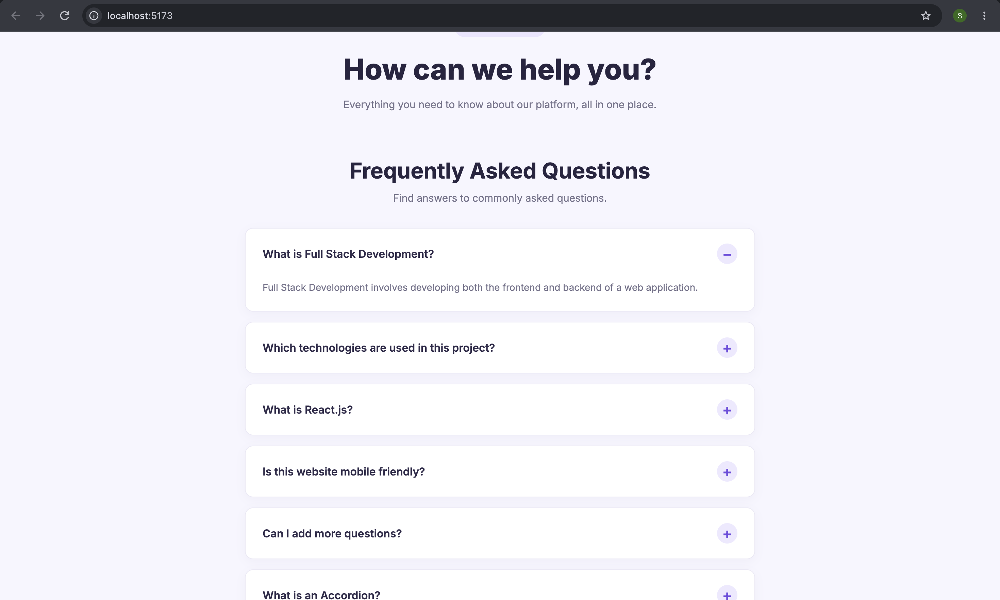

# FAQ Accordion
## Project Preview



A responsive and interactive FAQ Accordion web application built using React, TypeScript, Vite, and CSS.

## About the Project

The FAQ Accordion is a simple web application that displays frequently asked questions and their answers in an expandable format.

When a user clicks on a question, its answer expands. If another question is clicked, the previously opened answer automatically closes.

This project demonstrates React components, state management, event handling, conditional rendering, and responsive web design.

## Features

- Displays multiple frequently asked questions.
- Expand and collapse answers on clicking questions.
- Automatically closes the previously opened answer.
- Smooth expand and collapse animations.
- Interactive hover effects.
- Responsive design for desktop and mobile devices.
- Accessible accordion controls.

## Technologies Used

| Technology | Purpose |
|---|---|
| React.js | Building user interfaces |
| TypeScript | JavaScript with static typing |
| HTML | Webpage structure |
| CSS | Styling and responsive design |
| Vite | Development server and build tool |
| ESLint | Code quality and error checking |

## Project Structure

```text
faq-accordion/
│
├── public/
│
├── src/
│   ├── components/
│   │   └── FAQ.jsx
│   │
│   ├── App.tsx
│   ├── App.css
│   ├── index.css
│   └── main.tsx
│
├── index.html
├── package.json
├── package-lock.json
├── vite.config.ts
└── README.md
```

## Installation and Setup

### 1. Clone the repository

```bash
git clone https://github.com/YOUR_USERNAME/faq-accordion.git
```

### 2. Navigate to the project folder

```bash
cd faq-accordion
```

### 3. Install dependencies

```bash
npm install
```

### 4. Start the development server

```bash
npm run dev
```

### 5. Open in browser

Visit:

http://localhost:5173/

## How It Works

1. FAQ questions and answers are stored in a JavaScript array of objects.
2. React's useState Hook manages the currently active question.
3. The onClick event handles user interactions.
4. Conditional rendering controls the visibility of answers.
5. CSS provides animations, hover effects, and responsive layouts.

## Future Enhancements

- Add a search feature for questions.
- Add FAQ categories.
- Integrate a backend API.
- Store questions and answers in a database.
- Create an admin panel to manage FAQs.

## Project Information

**Project Name:** Simple FAQ Accordion

**Subject:** Full Stack Development

**Frontend Library:** React.js

**Build Tool:** Vite

## Author

Sanika Patil
